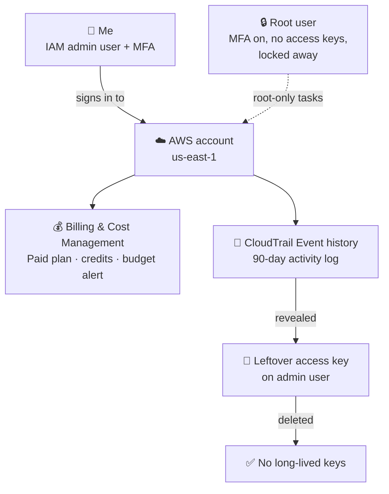

# Episode 0 — Setup: Lock Down the Account Before Building

**Services:** IAM · CloudTrail · Billing and Cost Management (Budgets, Credits)

## What I built
Nothing that runs yet. This episode is the foundation for CrackDispatch, a pothole reporting and repair-crew tracking app I'm building on AWS one episode at a time. I confirmed my account plan and credits, verified MFA on both the root user and my IAM admin user, reviewed my budget alert, explored CloudTrail Event history, and created this repo.

## Architecture
```
Me (IAM admin user + MFA)
      │  signs in to
      ▼
AWS account (us-east-1)
      ├──► Billing & Cost Management: plan, credits, budget alert
      └──► CloudTrail Event history: 90-day log of account activity
```



## What broke and how I fixed it
While reviewing my admin user's IAM Security Credentials, I spotted an access key leftover from earlier experimenting. I learned that a long-lived key on an admin user is a common way accounts get compromised, so I confirmed the surrounding activity was mine and deleted the key.

## Exam takeaways
- Root user: enable MFA, never create root access keys, use it only for root-only tasks.
- When an AWS service needs access to another service, use an **IAM role**, not access keys.
- Budgets **alerts**, Cost Explorer **analyzes**, CloudTrail **audits**, Config **records changes**.
- Event history keeps 90 days. For longer retention, create a trail that delivers to S3.

## Cost
$0. No billable resources were created.
