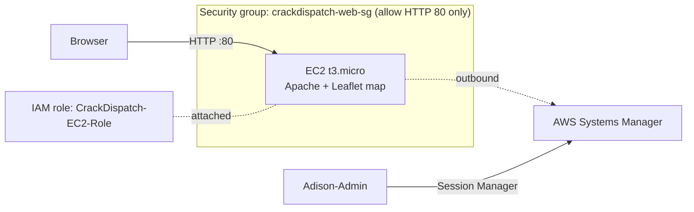

# Episode 1: A pothole map on one server

*CrackDispatch is a work-order and crew-tracking app for a fictional paving contractor. All data is made up.*

## What I built
- **Quest 1 (IAM):** I set up a least-privilege group and an IAM role that EC2 is allowed to use (`AmazonSSMManagedInstanceCore`).
- **Quest 2 (EC2):** I launched a t3.micro web server on Amazon Linux 2023. A **user data** script installs Apache on first boot and writes a Leaflet + OpenStreetMap page showing five sample work orders in New Orleans, so the server builds itself.

I get into the server through **Session Manager**, using the role. There are no SSH keys, and port 22 is never opened.

## Architecture

## What broke and how I fixed it
- **Quest 1:** An inline policy with an explicit deny blocked an action the group allowed. I found it and removed it with no hints. Explicit deny always wins.
- **Quest 2:** A mock ticket asked me to switch the security group rule from HTTP to HTTPS "for security." After I did, neither address loaded:
  - `http://` failed because no rule allowed port 80 anymore.
  - `https://` failed because Apache had no certificate, so nothing answered on 443.

  I needed hints to work this out. The fix was to restore the HTTP 80 rule. Lesson: when something breaks right after a change, check that change first.

## Exam takeaways
- Security groups are stateful and allow-only.
- User data runs only on first boot.
- HTTPS needs a certificate. On AWS, it usually goes on a load balancer, using a certificate from AWS Certificate Manager (ACM).
- Session Manager means no inbound ports, no SSH keys, and sessions that can be logged.

## Cost
About $0.03: one t3.micro (about $0.0104/hr) plus a public IPv4 address (about $0.005/hr) for about an hour. The instance was terminated afterward.

## Files
- [`user-data.sh`](user-data.sh): the first-boot script that builds the server
