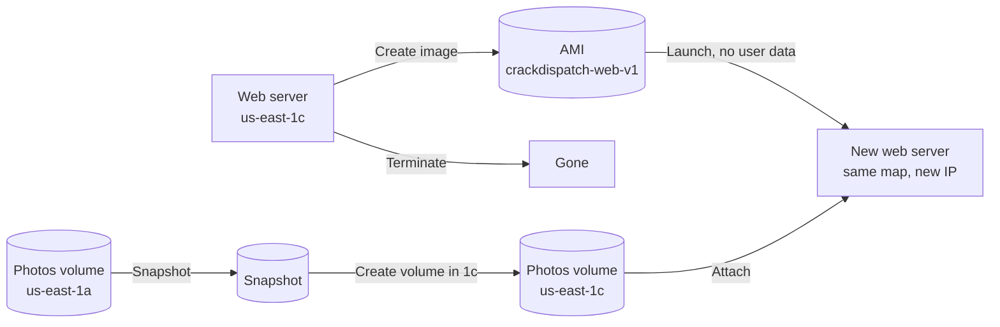

# Episode 2: Kill the server, bring it back

## What I built
I launched a web server that serves the CrackDispatch pothole map, saved it as an AMI (Amazon Machine Image), terminated the server, then launched a new one from the AMI. The new server served the same map with no setup script. Only the IP address changed. I also added a separate "Pothole Photos" EBS volume to the server, and practiced EC2 placement groups (cluster, spread, partition).

## Architecture

## What broke and how I fixed it
The photos volume was deliberately created in us-east-1a, but the server was in us-east-1c, so the server didn't appear as a choice when attaching. You can't change a volume's AZ (Availability Zone). I snapshotted the volume, created a new volume from the snapshot in us-east-1c, attached it, and deleted the old one.

## Exam takeaways
- EBS volumes are locked to one AZ. Snapshots move data across AZs (and across regions, by copying).
- AMIs are regional. Copy them to another region for disaster recovery.
- A new instance gets a new public IP. For a stable address, use a load balancer or DNS name.
- Placement groups: cluster = speed, spread = isolation (max 7 per AZ), partition = large distributed systems.

## Cost
Lab instances: a few cents. The AMI snapshot (1.68 GiB) costs about $0.08/month to keep.
