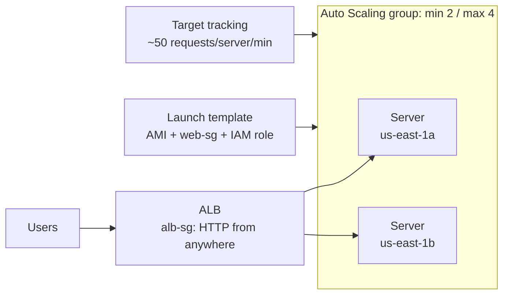

# Episode 3: Surviving a storm spike

## What I built
An Application Load Balancer (ALB) across two Availability Zones, in front of an Auto Scaling group (min 2, desired 2, max 4). A launch template builds every server from my saved AMI, with the security group and the IAM role for Session Manager. A target tracking policy aims for about 50 requests per server per minute. To simulate a storm of pothole reports, I connected to one server through Session Manager and ran a request loop. Requests per server (and CPU) spiked, and the group scaled out to its max of 4. When I terminated a server, the group replaced it automatically, and the site stayed up.

## Architecture

## Exam takeaways
- Turn on ELB health checks, and set a grace period longer than app startup.
- Target tracking for unpredictable spikes, scheduled scaling for known patterns.
- Chain security groups (ALB SG → server SG) instead of using IP ranges.

## Cost
About 5–15¢ per session (ALB ≈ $0.0225/hour plus t3.micro servers). Torn down after each session.
