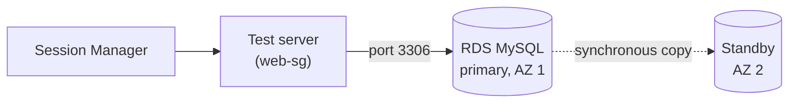

# Episode 4: Giving the map a memory

## What I built
I provisioned an Amazon RDS MySQL database for CrackDispatch and made a table called `pins` for the pothole, crack and sidewalk reports. Before this, every server kept pins in its own memory, so a dead server meant lost pins. Then I switched the database to Multi-AZ for availability and forced a failover so I could watch it happen with my own eyes. It did, and the database was back within minutes.

## Architecture

The database isn't public. Its security group only allows port 3306 from instances wearing the `web-sg` badge.

## What broke and how I fixed it
- **Access denied:** I mistyped the password. Pasting it fixed it, and the error proved the network path worked.
- **Multi-AZ stuck on "No":** the change was waiting for the maintenance window. I re-applied it with *Apply immediately*.
- **Break-it:** the database security group's source was changed to `alb-sg`through a directed small exercise, so connections timed out. My servers wear `web-sg`, so I switched it back.

## Exam takeaways
- Multi-AZ keeps a standby copy that's always running. On failover it's promoted, and the endpoint name stays the same.
- The standby can't serve reads. Read replicas are for read scaling.

## Cost
A few cents. I tore everything down and kept one small final snapshot.
